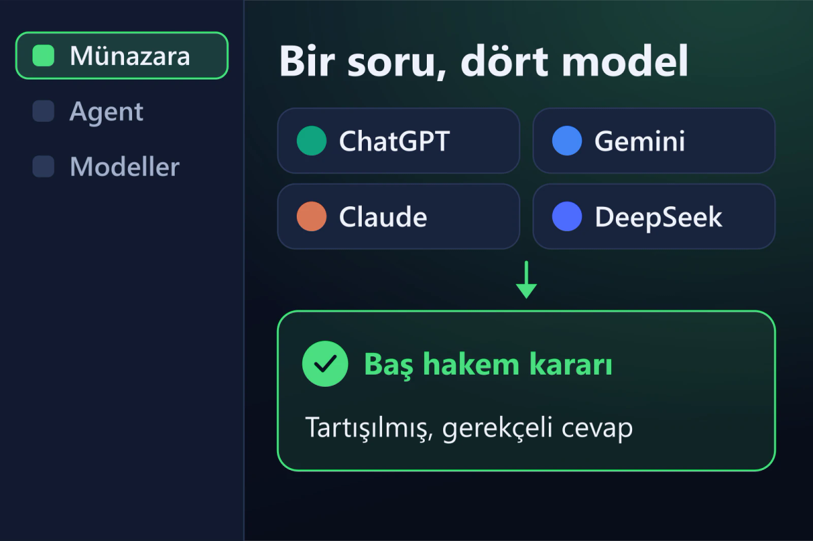

<div align="center">


# RVLX AI

**Tek bir yapay zekâya değil, bir kurula sorun.**

<a href="https://www.arvelx.com/urunler/rvlx-ai"></a> <a href="https://github.com/tlgtrzi-code/RVLX-AI/releases/latest"></a> 

</div>

---

<div align="center">

</div>

Masaüstü yapay zekâ çalışma alanı: modeller tartışır, hakemler karar verir, agent'lar işi sizin yerinize takip eder.

## ✨ Neler yapar

- ⚖️ **Münazara** — sorunuz ChatGPT, Gemini, Claude, DeepSeek ve seçtiğiniz diğer sağlayıcılara aynı anda gider. Modeller en fazla 3 turda birbirinin cevabını eleştirip kendini düzeltir; hakemler gerekçeli karar yazar, baş hakem son kararı verir.
- 🤖 **Agent'lar** — Tek Seferlik bir işi yapar ve biter; Sürekli Takip bir konuyu aralıkla kontrol eder; Otonom Agent hedefi adımlara böler ve bitirir; Canlı İzleme değişiklik olunca devreye girer.
- 🌐 **Web oturumları** — sitelere kendi hesabınızla bir kez giriş yaparsınız; münazara ve uygulama içi tarayıcı bu oturumları ortak kullanır. Parolanız saklanmaz.
- 🧠 **Modeller** — yerel modeller (Ollama, LM Studio) bilgisayarınızda çalışır; kendi API anahtarınızla ya da ChatGPT aboneliğinizle bulut modellerine bağlanırsınız.
- 🧩 **Beceriler** — kendi iş akışlarınızı agent'a beceri olarak öğretin.

## 🎁 Free ve Pro

| | Free | Pro |
|---|---|---|
| Hesap | gerekmez | ARVELX hesabı |
| Süre | süresiz | 1, 6 ya da 12 ay |
| Modeller ve Tek Seferlik agent | ✅ | ✅ |
| Münazara, sürekli çalışan agent'lar, web oturumları | — | ✅ |
| Kendi beceriniz | 3 | sınırsız |

Fiyatlar: **[arvelx.com/fiyatlandirma](https://www.arvelx.com/fiyatlandirma)** · Lisans: **[arvelx.com/lisans-al/rvlx-ai](https://www.arvelx.com/lisans-al/rvlx-ai)**

## 📦 İndirme ve doğrulama

1. **[Releases](https://github.com/tlgtrzi-code/RVLX-AI/releases/latest)** bölümünden `RVLX-AI-Setup-<sürüm>.exe` dosyasını indirin.
2. Dosyayı sürümle gelen `SHA256SUMS.txt` ile doğrulayın:

   ```powershell
   Get-FileHash .\RVLX-AI-Setup-0.2.0.exe -Algorithm SHA256
   ```

   Çıkan değer `SHA256SUMS.txt` içindekiyle aynı olmalıdır.
3. Kurun. Kurulum sırasında kurulum klasörünü seçebilirsiniz.

## 🧩 Diğer ARVELX ürünleri

| | Ürün | |
|---|---|---|
| 🧾 | **RVLX Kasa** — kasa, fatura ve raf yönetimi (Windows) | [Sürümler](https://github.com/tlgtrzi-code/RVLX-Kasa) · [Ürün sayfası](https://www.arvelx.com/urunler/rvlx-kasa) |
| 📱 | **RVLX Media** — tarayıcı, indirici ve müzik çalar (Android) | [Sürümler](https://github.com/tlgtrzi-code/RVLX-Media) · [Ürün sayfası](https://www.arvelx.com/urunler/rvlx-media) |
| 💻 | **RVLX Media Desktop** — hızlı indirme yöneticisi (Windows) | [Sürümler](https://github.com/tlgtrzi-code/RVLX-Media-Desktop) · [Ürün sayfası](https://www.arvelx.com/urunler/RVLX-Media-Desktop) |

## ℹ️ Bu depo hakkında

Bu depo RVLX AI'nin **genel dağıtım** noktasıdır: kurulum dosyası, sürüm notları ve doğrulama değerleri **Releases** bölümünde yayınlanır. Kaynak kod burada bulunmaz.

Destek: **[arvelx.com/iletisim](https://www.arvelx.com/iletisim)** · [Facebook](https://www.facebook.com/Arvelx/) · [Instagram](https://www.instagram.com/arvelxai/) · [YouTube](https://www.youtube.com/@Arvelx-RVLX)

<div align="center">
<br>
<a href="https://www.arvelx.com"></a>
<br><sub>© ARVELX · RVLX ürün ailesi</sub>
</div>
